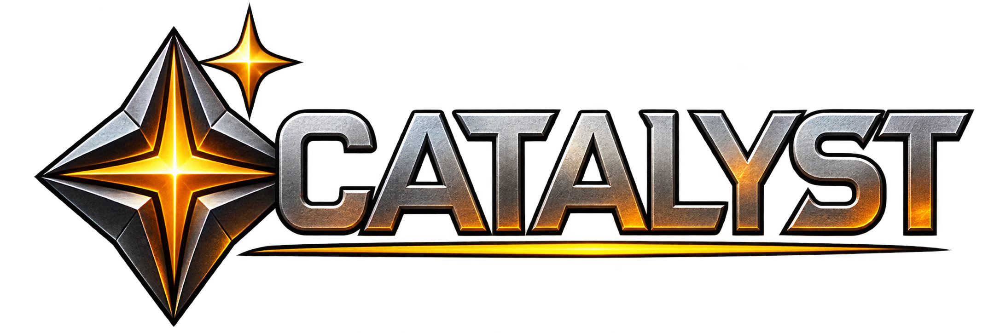

  

# Catalyst

Offline-first tabletop RPG campaign and Game Master studio.

This repository was initialized from the independently maintained LithoMark foundation; see [docs/catalyst/MIGRATION-FROM-LITHOMARK.md](docs/catalyst/MIGRATION-FROM-LITHOMARK.md).

## Branding

The original artwork lives in [`images/`](images/) and must not be edited:

- `images/catalyst-icon.png`: app, window and taskbar icon. All Tauri icon sizes in `src-tauri/icons/` are generated from it with `npx tauri icon images/catalyst-icon.png -o src-tauri/icons`.
- `images/catalyst-logo.png`: the Catalyst wordmark logo. The app uses a resized copy at `src/assets/catalyst-logo.png`.
